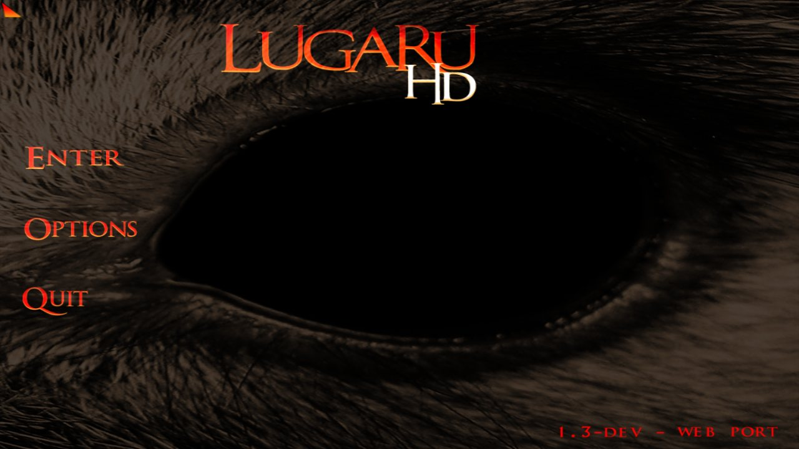
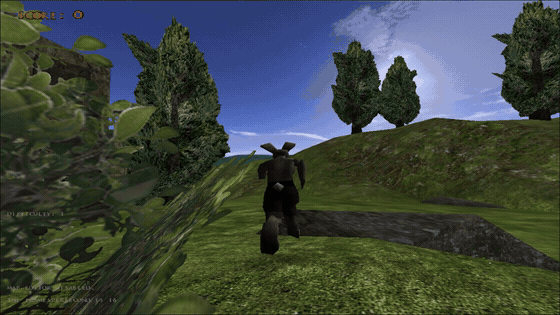
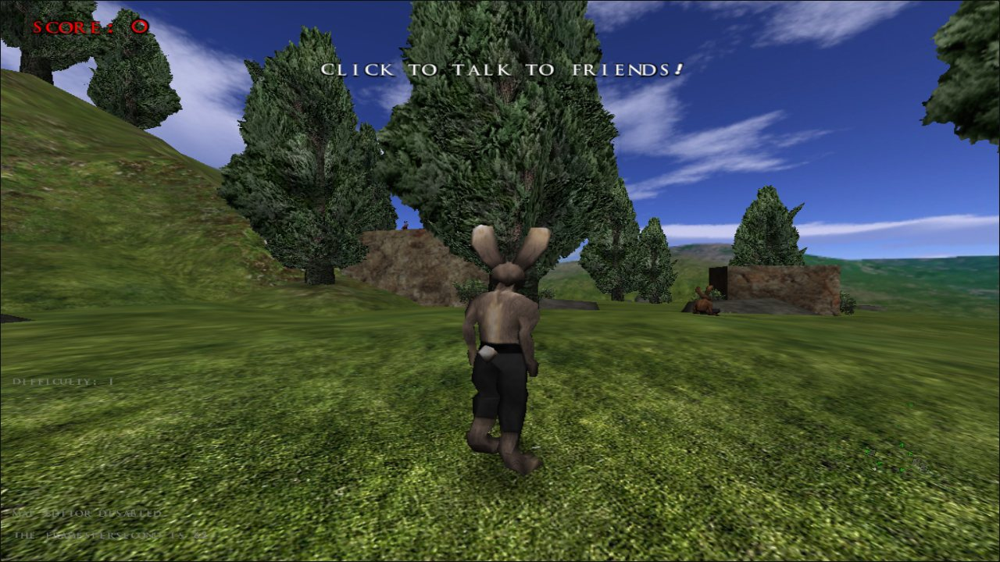
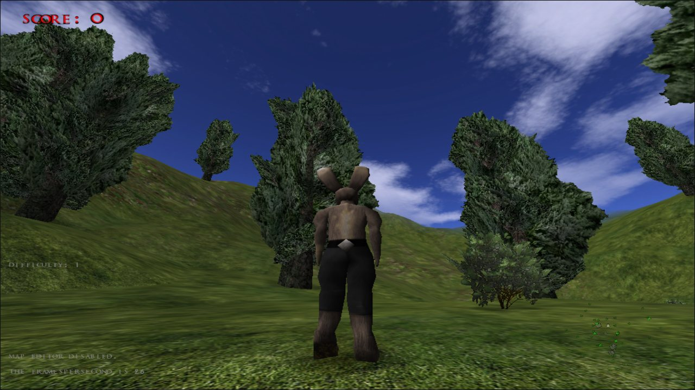
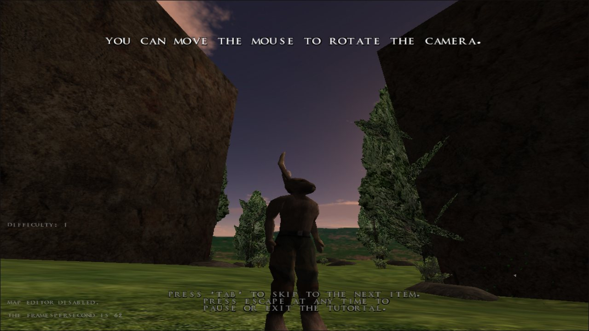
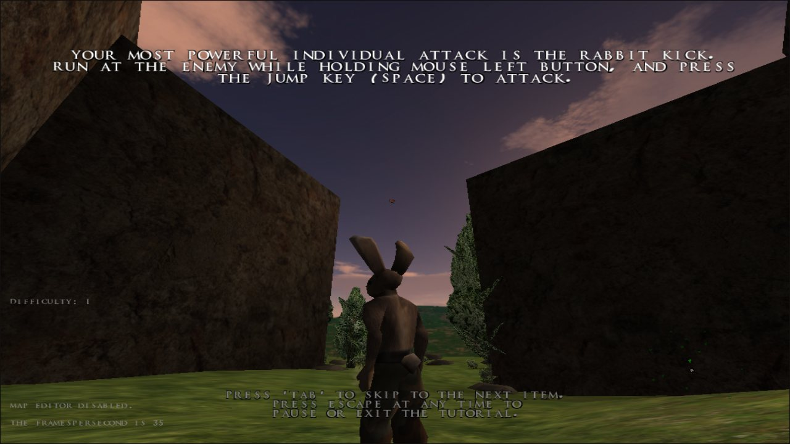

<div align="center">



#  lugaru-web

### *Lugaru HD, the cult-classic rabbit kung-fu game, running natively in your browser.*

**WebAssembly  WebGL  Zero install**

[](https://zaedian.github.io/lugaru-web/)

     

[Play](#play)  [Screenshots](#screenshots)  [Run locally](#run-locally)  [Controls](#controls)  [How it works](#how-it-works)  [Roadmap](#roadmap)  [Credits](#credits)

</div>

---

<div align="center">
  
  <br>
  <sub><i>Recorded in the browser: Turner sprinting across the hills of the first campaign level.</i></sub>
</div>

---

##  About the game

> **Lugaru** (pronounced *Loo-GAH-roo*) is a third-person action game originally developed by **Wolfire Games**.

You play as **Turner**, an anthropomorphic rebel rabbit with serious combat skills. In his quest to find those responsible for slaughtering his village, he uncovers a far-reaching conspiracy involving the corrupt leaders of the rabbit republic and the starving wolves from a nearby den.

Lugaru is known for its **context-sensitive, physics-driven melee combat**: reversals, rabbit kicks, wall-flips, sweeps, knives, swords and staffs, with ragdoll physics that still hold up today.

**lugaru-web** brings the open-source **OSS Lugaru** (1.3-dev) to modern browsers using WebAssembly and WebGL. The goal is a smooth, near-native experience you can play from a link, with no download, installer or plugin.

<a id="play"></a>

##  Play

[](https://zaedian.github.io/lugaru-web/)

1. Open the link and wait for the game data to download (~42 MB on the first visit).
2. Click **Enter**, then **New User**. Type a name and press <kbd>Enter</kbd>.
3. Pick a difficulty and choose **Tutorial** (recommended) or the **Village** to start the campaign.
4. Click inside the game to capture the mouse. Press <kbd>Esc</kbd> to pause and release it.

>  Your profiles, progress and settings are saved in your browser, so they're still there next time.

<a id="screenshots"></a>

##  Screenshots

<table>
  <tr>
    <td width="50%"></td>
    <td width="50%"></td>
  </tr>
  <tr>
    <td align="center"><sub><b>The Village</b>: the campaign begins</sub></td>
    <td align="center"><sub><b>The Hills</b>: full 3D terrain, foliage and skybox</sub></td>
  </tr>
  <tr>
    <td width="50%"></td>
    <td width="50%"></td>
  </tr>
  <tr>
    <td align="center"><sub><b>Tutorial</b>: learn to move, flip and wall-jump</sub></td>
    <td align="center"><sub><b>Basic Combat</b>: sparring with the imaginary enemy</sub></td>
  </tr>
</table>

<sub>All screenshots were captured from this web build running in Chromium.</sub>

##  Features

|   | Feature |
|---|---------|
| **WebAssembly + WebGL runtime.** The original C++ engine is compiled with Emscripten and plays directly in the browser. |
| **Gamepad support.** Native PS4 and standard modern gamepad input through the browser Gamepad API. |
| **Tear-free rendering.** The render loop is synchronised to `requestAnimationFrame`. |
| **Persistent saves.** User profiles, campaign progress and settings are stored in your browser and survive reloads. |
| **Pointer-lock mouse look.** Click to capture the mouse for proper third-person camera control, and <kbd>Esc</kbd> to release it. |
| **Fully static.** Four files and any web server. No backend required. |

<a id="run-locally"></a>

##  Run it locally

The game must be served over **HTTP**. Opening `index.html` directly (`file://`) won't work, because browsers block WebAssembly and data fetches from local files.

```bash
git clone https://github.com/zaedian/lugaru-web.git
cd lugaru-web
python3 -m http.server 8080
```

Then open **http://localhost:8080** in your browser.

<details>
<summary><b>Other ways to serve it</b></summary>

<br>

```bash
# Node.js
npx serve -l 8080 .

# PHP
php -S localhost:8080
```

Any static file host works too, for example GitHub Pages, Netlify, Cloudflare Pages or nginx. If your server lets you configure MIME types, serve `.wasm` as `application/wasm` so it can be compiled while it downloads.

</details>

<a id="build"></a>

## Build from source

Requires the **Emscripten SDK** (`emsdk/`) in the repository root (see [Emscripten install](https://emscripten.org/docs/getting_started/downloads/)). The source is standard CMake; the web-specific files (`GLShim`, `gl_stub`) are already included under `source/Source/Web/` and `source/cmake/emscripten/`.

```powershell
.\tools\build-lugaru-web.ps1
```

Output appears in `docs/`.

<a id="controls"></a>

## Controls

These are the default bindings. They can be changed in **Options -> Configure Controls**.

| Action | Keyboard / Mouse |
|--------|------------------|
| Move | <kbd>W</kbd> <kbd>A</kbd> <kbd>S</kbd> <kbd>D</kbd> (relative to the camera) |
| Look around | Mouse |
| Jump (hold for higher) | <kbd>Space</kbd> |
| Crouch / Roll (while running) / Flip (in the air) | <kbd>Left Shift</kbd> |
| Attack | <kbd>Left Mouse Button</kbd> |
| Draw / sheathe weapon | <kbd>E</kbd> |
| Throw weapon | <kbd>Q</kbd> |
| Skip tutorial step | <kbd>Tab</kbd> |
| Pause menu / release mouse | <kbd>Esc</kbd> |
| Developer console | <kbd>`</kbd> (backtick) |

>  **Combat tips from the tutorial:** attacking while running gives a **spin kick**. Attack while crouched to **sweep** the enemy's legs. Run at an enemy holding attack, then press jump, for the devastating **rabbit kick**.

<a id="how-it-works"></a>

##  How it works

| File | Size | What it is |
|------|------|------------|
| `index.html` | 4&nbsp;KB | Page shell: full-screen canvas, `Module` config and safe pointer-lock handling |
| `lugaru.js` | 340&nbsp;KB | Emscripten JS glue: virtual filesystem, SDL2 input/audio and the OpenGL / WebGL emulation layer |
| `lugaru.wasm` | 2.3&nbsp;MB | The Lugaru engine (C++ / SDL2 / legacy OpenGL), compiled to WebAssembly |
| `lugaru.data` | 38&nbsp;MB | Preloaded game assets, unpacked into an in-memory filesystem at startup |

**Under the hood**

- **Legacy OpenGL on WebGL.** Lugaru uses fixed-function, immediate-mode OpenGL. Emscripten's GL emulation (`LEGACY_GL_EMULATION`) translates those calls to WebGL at runtime.
- **Main loop.** The engine's game loop runs as an Emscripten main loop driven by `requestAnimationFrame`, so frames line up with the display and the tab stays responsive.
- **Saves.** The game reads and writes its usual files (`~/.config/lugaru/config.txt` and `~/.local/share/lugaru/users`) on Emscripten's virtual filesystem. These are mirrored to `localStorage` (`lugaru_config` and `lugaru_users`) so they persist between visits.
- **Input.** Keyboard and mouse go through SDL2. The mouse uses the Pointer Lock API, and controllers use the Gamepad API.

<a id="roadmap"></a>

##  Roadmap

- [x] WebAssembly + WebGL build
- [x] PS4 / standard gamepad support with sensitivity settings.
- [x] `requestAnimationFrame`-synchronised rendering
- [x] Persistent profiles and settings

##  Known issues

- **None.**  All previous known issues have been resolved. If you encounter any new bugs, feel free to open an issue or let us know!

##  History

Lugaru was created by **David Rosen** of [Wolfire Games](https://www.wolfire.com/) and open-sourced in 2010 with help from **Ryan C. Gordon**. Contributions from various forks were then consolidated under the [**OSS Lugaru**](https://osslugaru.gitlab.io) project to keep the codebase active, cross-platform and maintainable. **lugaru-web** builds on that work and brings the game to the web.

<a id="credits"></a>

##  Credits & licensing

- **Game design & original code:** David Rosen / [Wolfire Games](https://www.wolfire.com/)
- **Open-source maintenance:** the [OSS Lugaru](https://osslugaru.gitlab.io) contributors
- **Web port:** [zaedian](https://github.com/zaedian), [harrythentrepreneur](https://github.com/harrythentrepreneur), [ryandeering](https://github.com/ryandeering/loupgarenne), [loganwalkerdev](https://github.com/loganwalkerdev/lugaru-web).

| Component | License |
|-----------|---------|
| Source code & compiled web binaries | [GNU GPL v2](https://www.gnu.org/licenses/old-licenses/gpl-2.0.html) or (at your option) any later version |
| Game assets in `lugaru.data` (models, textures, audio, campaigns) | [CC BY-SA 3.0 Unported](https://creativecommons.org/licenses/by-sa/3.0/) and [CC BY-SA 4.0 International](https://creativecommons.org/licenses/by-sa/4.0/) |

>  **If you enjoy the game, please support the original developers** by buying **Lugaru HD** on [Steam](https://store.steampowered.com/app/25010/Lugaru_HD/) or [Humble Bundle](https://www.wolfire.com/lugaru) (buy links on Wolfire's site).
